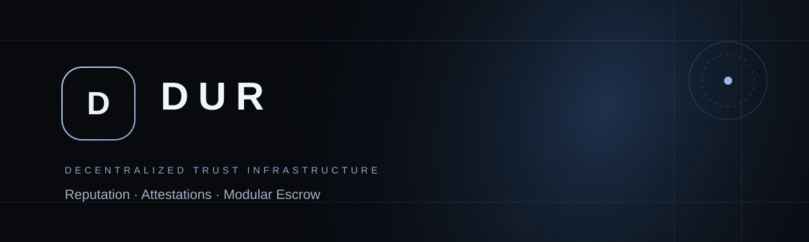

# DUR Protocol

<p align="center"></p>

<p align="center">
  <strong>Decentralized Trust Infrastructure for TON</strong><br/>
  Verifiable reputation · Attestations · Modular escrow
</p>

<p align="center">
  <a href="https://github.com/voynovsenior/DUR/actions/workflows/ci.yml"></a>
  
  
  
</p>

DUR is an early-stage project exploring a modular trust layer for applications in the TON ecosystem. It aims to make reputation portable, attestations verifiable, and escrow components reusable by third-party applications.

> **Development status:** prototype / early development. This repository does not yet implement production reputation scoring, a live attestation registry, or executable escrow smart contracts. The current Mini App is an interface prototype. No real funds should be sent to or managed by this software.

## Product vision

DUR is designed around independently composable modules:

- **Reputation** — a portable view of evidence-backed activity, with transparent methodology rather than an unexplained score.
- **Attestations** — structured claims with identifiable issuers, evidence references, verification status, and revocation paths.
- **Escrow** — a modular agreement lifecycle that can integrate with Reputation without being tightly coupled to it.
- **Verification** — checks that distinguish on-chain facts from off-chain claims and issuer assertions.
- **Developer interfaces** — APIs and SDKs intended to let external TON applications consume and issue supported evidence.

The initial deployment target is **TON Testnet**. Mainnet deployment is out of scope until implementation, testing, and independent security review are complete.

## Current prototype

The first UI package includes:

- responsive, dark futuristic Telegram Mini App interface;
- Overview, Reputation, Attestations, Escrow, and Settings screens;
- TON Connect wallet connection UI;
- Telegram WebApp initialization and basic haptic feedback;
- a minimal Telegram bot using grammY;
- explicit preview states that do not fabricate reputation values or transaction activity.

### Screens and modules

| Module | Current state |
|---|---|
| Mini App UI | Prototype |
| Telegram bot | Starter implementation |
| TON Connect | UI integration; manifest must be configured |
| Reputation engine | Not implemented |
| Attestation registry | Not implemented |
| Escrow contracts | Not implemented |
| Backend API | Telegram authentication, session management and limited TON Proof wallet linking implemented; reputation/attestation/escrow APIs pending |
| Chain indexer | Not implemented |

## Repository structure

```text
.
├── bot/                    # Telegram bot (grammY)
├── backend/
│   ├── src/identity/       # Telegram and TON proof verification, SQLite accounts, sessions and wallet links
│   ├── src/attestations/   # Canonical claim validation and digest helper
│   ├── src/server.ts       # HTTP API
│   └── test/               # API and identity tests
├── docs/
│   ├── ARCHITECTURE.md     # System boundaries and components
│   ├── SECURITY.md         # Security assumptions and threat model
│   ├── ROADMAP.md          # Development milestones
│   └── PROTOCOL.md         # Concepts and evidence model
├── public/
│   └── tonconnect-manifest.json
├── src/
│   ├── App.tsx             # Mini App screens
│   ├── main.tsx            # React entry point
│   └── styles.css          # Visual system
├── .github/workflows/      # CI
├── .env.example
├── index.html
├── package.json
└── vite.config.ts
```

## Getting started

### Requirements

- Node.js 20 or newer
- npm
- HTTPS hosting for Telegram Mini App testing
- A TON wallet configured for Testnet when wallet testing is needed

### Install and run the Mini App

```bash
git clone https://github.com/voynovsenior/DUR.git
cd DUR
npm install
cp .env.example .env
npm run dev
```

Vite prints a local development URL. A Telegram Mini App must be served over HTTPS and registered with the bot before it can be tested inside Telegram.

### Configure TON Connect

1. Deploy the frontend to an HTTPS origin.
2. Update `public/tonconnect-manifest.json` with the deployed app URL and a publicly reachable icon URL.
3. Set `VITE_TONCONNECT_MANIFEST_URL` to the full HTTPS URL of that manifest. Set `VITE_API_BASE_URL` if the API is hosted on a separate origin; leave it empty when `/v1` is reverse-proxied under the app origin.
4. Confirm that the manifest is publicly accessible.

The committed manifest contains placeholders. Wallet connection is not fully configured until those values are replaced.

### Run the API

Set `TELEGRAM_BOT_TOKEN`, `TON_APP_DOMAIN` (your exact dApp hostname), and `TON_NETWORK_ID=-3` in the server environment (the backend loads local `.env` files through dotenv), then run:

```bash
npm run api
```

The API creates its SQLite database at `./data/dur.sqlite` by default. Set `DUR_DATABASE_PATH` to change the location. For local HTTP testing only, set `COOKIE_SECURE=false`; deployed environments must keep Secure cookies enabled and configure `CORS_ORIGIN` to the exact HTTPS frontend origin.

Telegram login is available at `POST /v1/auth/telegram` and uses raw `Telegram.WebApp.initData`. TON Connect `ton_proof` wallet linking is available for supported standard wallets when `TON_APP_DOMAIN` is configured. The verifier currently rejects unrecognized wallet code versions; CI validation and deployment QA are still pending.

### Run the Telegram bot

Set `BOT_TOKEN` and `MINI_APP_URL` in the host's private environment variables, then run:

```bash
npm run bot
```

Never commit a real bot token. Do not send bot tokens, seed phrases, or private keys in issues, pull requests, screenshots, or chat.

## Design principles

1. **Evidence over assertions.** A client-submitted hash or button click is not proof of a blockchain event.
2. **Separation of concerns.** Reputation and Escrow are independently composable modules.
3. **Explainability.** Any future reputation output must be traceable to evidence and documented rules.
4. **Non-custodial by default.** DUR must not collect wallet seed phrases or private keys.
5. **Testnet first.** No production-value escrow is part of this prototype.
6. **Privacy-aware verification.** Collect only the data required for a defined protocol purpose.

## Documentation

- [Architecture](docs/ARCHITECTURE.md)
- [Identity Layer](docs/IDENTITY.md)
- [API preview](docs/API.md)
- [Protocol concepts](docs/PROTOCOL.md)
- [Security model](docs/SECURITY.md)
- [Roadmap](docs/ROADMAP.md)
- [Contributing](CONTRIBUTING.md)
- [Security reporting](SECURITY.md)

## Contributing

Issues, documentation improvements, design feedback, and carefully scoped code contributions are welcome. Read [CONTRIBUTING.md](CONTRIBUTING.md) before opening a pull request. Please do not submit real secrets or claim that unimplemented modules are production-ready.

## Disclaimer

DUR is an independent experimental software project. It is not an official TON Foundation product and is not endorsed by TON. All blockchain integrations described as planned or in development must be treated as unimplemented until verified in the code and on the relevant network. This repository is provided for development and educational purposes; it is not financial, legal, or investment advice.

## License

No open-source license has been granted yet. Until a license is added, standard copyright applies and reuse, redistribution, and modification are not automatically permitted.
